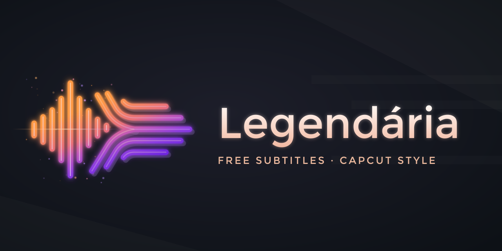

  

# Legendária

**English** | [Português (Brasil)](README.pt-BR.md)

**Free subtitles, CapCut style.** Free, open-source automatic subtitles for your videos, inspired by CapCut's auto captions.

*Legendária* blends the Portuguese word *legenda* (subtitle) with *legendary*. Its command-line tool is called `flosub`.

> 🚧 Early development. Nothing to install yet.

## What it will do

- **Transcribe automatically**, on your own computer (GPU-accelerated when available, CPU otherwise). No cloud, no account, no telemetry.
- **Edit visually in your browser:** a local editor that opens in your browser (nothing is uploaded). Every subtitle is a block on the timeline: click to fix the text, drag to adjust the timing, cut out the parts of the video you don't want, and see the final look live.
- **Export** SRT, VTT or ASS for YouTube and other platforms, or the video with the subtitles burned in.
- **Word-by-word animated captions** (CapCut style), coming after the first version.

## Goals

- A simple installer: next → next → finish, open the editor in your browser, drop your video in, click **Generate subtitles** and edit.
- Runs on **Linux, macOS and Windows 10+**.
- Available in **English and Brazilian Portuguese**. More languages are welcome.
- **Hackable:** defaults, models, style presets and translations live in JSON files you can edit.

## Status and roadmap

The transcription engine works today from the command line (`flosub`). The browser editor is being built ([plan 07](docs/dev-docs/planning/plan_07_web_editor.md)). An earlier Blender add-on is frozen and will probably be retired ([ADR-014](docs/dev-docs/decisions/ADR-014-web-editor-blender-frozen.md)). A documentation website and a video tutorial will come with the first release.

## Contributing

Contributions are welcome, including translations. Read [CONTRIBUTING.md](CONTRIBUTING.md), then [AGENTS.md](AGENTS.md) and [docs/PROJECT.md](docs/PROJECT.md): together they explain the project layout, the conventions and the current work.

## License

- Transcription engine and repository: [MIT](LICENSE)
- Blender add-on (frozen): GPL-3.0-or-later (required by Blender's extensions platform)
- Editor icons: [Solar Linear](https://www.figma.com/community/file/1166831539721848736) by 480 Design, [CC BY 4.0](https://creativecommons.org/licenses/by/4.0/)
