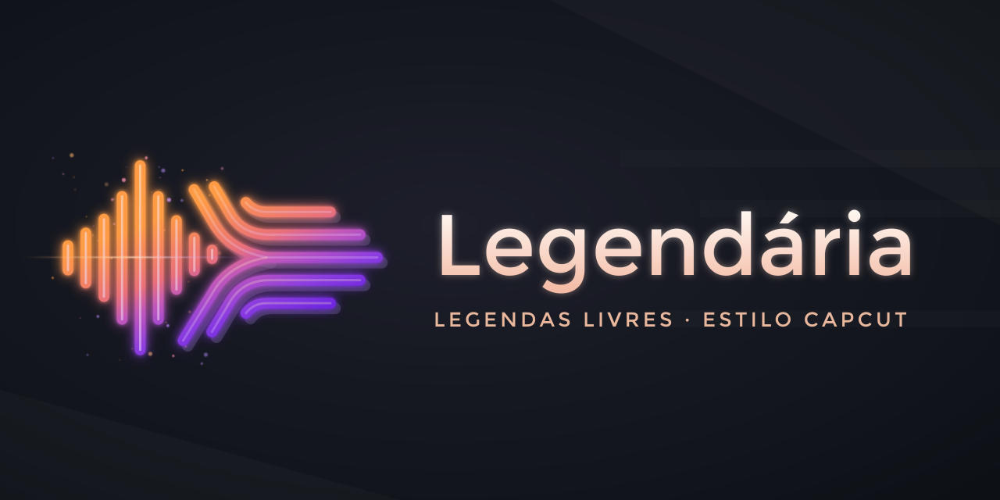

  

# Legendária

[English](README.md) | **Português (Brasil)**

**Legendas livres, estilo CapCut.** Legendas automáticas gratuitas e de código aberto para os seus vídeos, inspiradas nas legendas automáticas do CapCut.

O nome junta *legenda* com *legendary* (lendária, em inglês). A ferramenta de linha de comando se chama `flosub`.

> 🚧 Em desenvolvimento inicial. Ainda não há nada para instalar.

## O que ele vai fazer

- **Transcrever automaticamente**, no seu próprio computador (acelerado pela placa de vídeo quando houver, ou pelo processador). Sem nuvem, sem conta, sem coleta de dados.
- **Editar visualmente no Blender:** cada legenda é um bloco na linha do tempo. Clique para corrigir o texto, arraste para ajustar o tempo e estilize do seu jeito.
- **Exportar** SRT/VTT para o YouTube e outras plataformas, ou renderizar o vídeo com as legendas gravadas.
- **Legendas animadas palavra por palavra** (estilo CapCut), depois da primeira versão.

## Objetivos

- Instalador simples: avançar → avançar → concluir, abrir o Blender, colocar o vídeo e clicar em **Gerar legendas**.
- Funciona em **Linux, macOS e Windows 10+**.
- Disponível em **inglês e português do Brasil**. Outros idiomas são bem-vindos.
- **Personalizável:** padrões, modelos, estilos e traduções ficam em arquivos JSON que você pode editar.

## Status e próximos passos

O [plano](docs/dev-docs/planning/plan_01_mvp_engine_blender.md) tem o roadmap (a documentação técnica é em inglês). Um site de documentação e um vídeo tutorial virão com a primeira versão.

## Como contribuir

Contribuições são bem-vindas, inclusive traduções. Comece pelo [AGENTS.md](AGENTS.md) e pelo [docs/PROJECT.md](docs/PROJECT.md): juntos, eles explicam a estrutura, as convenções e o trabalho em andamento.

## Licença

- Motor de transcrição e repositório: [MIT](LICENSE)
- Add-on do Blender: GPL-3.0-or-later (exigência da plataforma de extensões do Blender)
